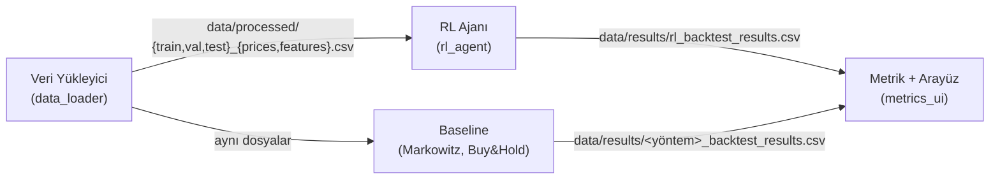

# Arayüz (Veri) Sözleşmesi

Bu belge, dört modülün birbirinden bağımsız ve paralel geliştirilebilmesi için **neyin hangi formatta
üretilip tüketileceğini** tanımlar. Kuralların kod karşılığı `src/rl_agent/market_data_validator.py`
dosyasındadır; kendi çıktınızı göndermeden önce şunu çalıştırın:

```bash
python src/rl_agent/market_data_validator.py
```



> **Durum:** Aşağıdaki başlıklardan **[ONAY]** etiketlileri öneridir; ekip onayı ile kesinleşir
> (PR üzerinde onaylanması yeterli). Etiketsizler teknik zorunluluktur.

---

## 1. Ortak sabitler

| Sabit | Değer | Not |
|---|---|---|
| Başlangıç sermayesi | `100_000` | Tüm yöntemlerde aynı |
| Komisyon | `%0.1` (`0.001`) | İşlem hacmi üzerinden, alım ve satımda ayrı ayrı |
| Pozisyon tipi | Yalnızca long, kaldıraçsız | Ağırlıklar ≥ 0 ve toplamı 1 (nakit dahil) |
| Nakit getirisi | `0` **[ONAY]** | TL için faiz kullanılacaksa **tüm yöntemlerde** aynı değer verilmeli |
| Gözlem penceresi (`WINDOW_SIZE`) | `10` iş günü | RL ortamı için, bkz. §4 |
| Hisse evreni | `THYAO.IS, GARAN.IS, ASELS.IS, KCHOL.IS, BIMAS.IS` **[ONAY]** | Sayı değişebilir (en az 2); kod hisse sayısına bağımlı değil |

## 2. Veri Yükleyici → RL / Baseline (`data/processed/`)

Her bölüm için iki dosya, toplam 6 dosya:

```
data/processed/train_prices.csv     train_features.csv
data/processed/val_prices.csv       val_features.csv
data/processed/test_prices.csv      test_features.csv
```

### Kronolojik bölünme **[ONAY]**

| Set | Aralık | Kullanım |
|---|---|---|
| `train` | 2018-01-01 → 2022-12-31 | Eğitim |
| `val` | 2023-01-01 → 2023-12-31 | Hiperparametre / erken durdurma / seed seçimi |
| `test` | 2024-01-01 → 2025-12-31 | **Yalnızca son raporlama**, ayar yapılmaz |

Setler çakışmaz, rastgele karıştırılmaz (`train_test_split` yasak). İndikatör ısınması için veri
2017 ortasından çekilmeli, **ısınma satırları (NaN) split'ten önce silinmelidir**; yani `train`
2018 başında dolu bir satırla başlar.

### Ortak dosya kuralları

- CSV, UTF-8, ilk sütun `Date` (`YYYY-MM-DD`), artan sırada, tekrarsız, iş günü.
- `prices` ve `features` dosyalarının **tarih indeksi birebir aynı**; her split'te sütun adları ve **sırası** aynı.
- NaN, `inf` yok.

### `*_prices.csv`

- Sütunlar: Yahoo kodlu hisseler (`THYAO.IS`, ...). **Sütun sırası = varlık sırası** (RL ağırlık sırası da budur).
- Değer: **düzeltilmiş kapanış** (bölünme/temettü düzeltmeli, `yfinance` `auto_adjust=True`), her zaman `> 0`.

### `*_features.csv`

- Sütun adı: `{HISSE}_{özellik}` (`.IS` olmadan), örn. `THYAO_rsi_norm`. Piyasa geneli özellik: `MKT_{özellik}`.
- **Her hisse için aynı sayıda özellik** olmalı.
- Özellikler **durağan ve ölçekli** olmalı: ham fiyat/hacim seviyesi **yok**. Önerilen: z-skor benzeri, `|x| ≤ 10`
  (`> 10` uyarı, `> 50` hata verir).
- **Ölçekleme parametreleri (ortalama/std) yalnızca `train` üzerinden hesaplanır**, `val` ve `test`'e aynen uygulanır.
- **Gelecek bilgisi yasak:** yalnızca geriye dönük pencereler (`rolling` merkezli olmaz, `shift(-k)` yok).
  `t` satırındaki özellik `t` günü kapanışına kadar bilinen bilgiyle hesaplanabilir.

## 3. RL / Baseline → Metrik + Arayüz (`data/results/`)

Her yöntem **aynı şemada** bir dosya üretir: `data/results/<yöntem>_backtest_results.csv`
(`rl_backtest_results.csv`, `buy_and_hold_backtest_results.csv`, `markowitz_backtest_results.csv`, ...).

| Sütun | Zorunlu | Anlam |
|---|---|---|
| `Date` | ✅ | `YYYY-MM-DD`, artan, tekrarsız |
| `Portfolio_Value` | ✅ | Gün sonu portföy değeri (**komisyon düşülmüş**) |
| `Daily_Return` | ✅ | **Net** getiri = `Portfolio_Value[t] / Portfolio_Value[t-1] - 1`. İlk satırda önceki değer `100_000` |
| `W_<HISSE>` | ✅ | Gün sonu ağırlıkları (fiyat kayması sonrası), ≥ 0 |
| `W_CASH` | ✅ | Nakit ağırlığı. Her satırda `W_*` toplamı = 1 |
| `Turnover`, `Commission` | ❌ | Opsiyonel (RL üretir) |

- **Sharpe, drawdown vb. yalnızca `Daily_Return` / `Portfolio_Value`'dan hesaplanır.** Bu iki sütunun tutarlılığı
  doğrulayıcı tarafından denetlenir (komisyonun getiriden gizlenmesi hata sayılır).
- Metrik modülü, dosyaları **ortak tarih aralığına** kırpar ve karşılaştırma için `Portfolio_Value`'yu 100.000'e yeniden tabanlar.

## 4. Başlangıç tarihi (adil kıyas için)

RL ortamı ilk kararı verebilmek için `WINDOW_SIZE = 10` günlük özellik geçmişine ihtiyaç duyar.
Bu nedenle **her yöntem `test` setinin 11. iş gününde (`index[10]`) kapanışta 100.000 ile başlar**;
sonuç dosyalarının ilk satırı `index[11]` tarihlidir. Baseline'lar da aynı günden başlamalıdır.

> Zamanlama notu: RL ortamı özellikleri bir gün gecikmeli kullanır (`t` günü kararı, `t-1`'e kadar olan
> özelliklerle verilir ve `t` kapanışından uygulanır). Dolayısıyla sızıntı riski yoktur.

## 5. Her üye için kısa kontrol listesi

- **Veri Yükleyici:** 6 dosyayı §2 kurallarıyla üret → `python src/rl_agent/market_data_validator.py` hatasız geçmeli.
- **Baseline:** Aynı `data/processed` dosyalarını oku, §4 başlangıcı ve §1 komisyonuyla çalış, §3 şemasında yaz.
- **Metrik + Arayüz:** `data/results/*_backtest_results.csv` dosyalarını oku; yalnızca §3 sütunlarına güven.
- **RL:** Bu sözleşmeye uyan her veriyle kod değişikliği olmadan çalışır.

Gerçek veri henüz yokken herkes `python src/rl_agent/dummy_data_generator.py` ile sözleşmeye uygun **sentetik**
veri üretebilir. Sentetik veriyle elde edilen sonuçlar stratejinin başarısını göstermez; yalnızca boru hattının çalıştığını doğrular.